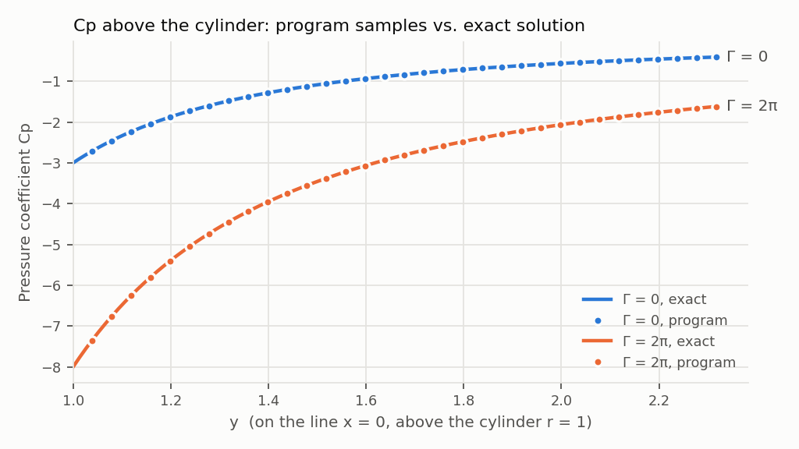
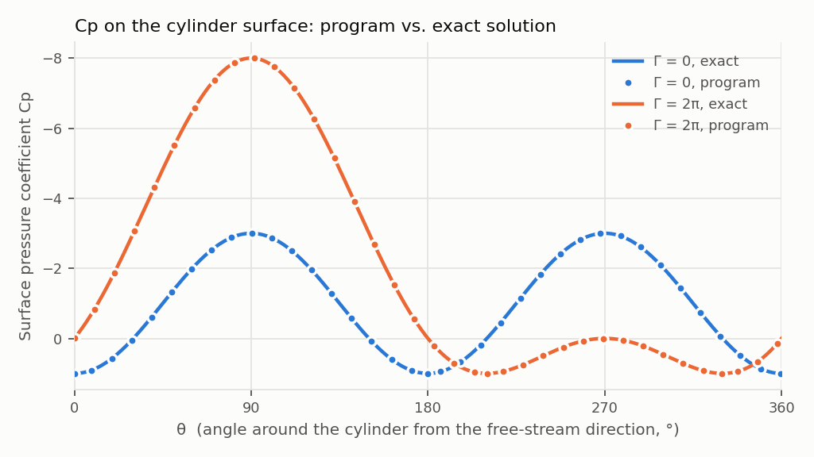
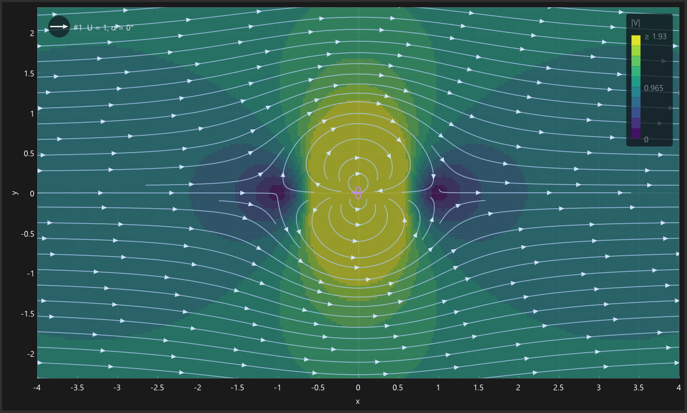
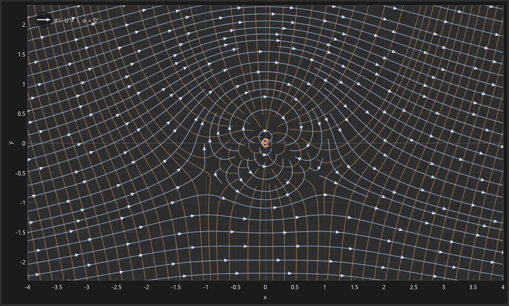
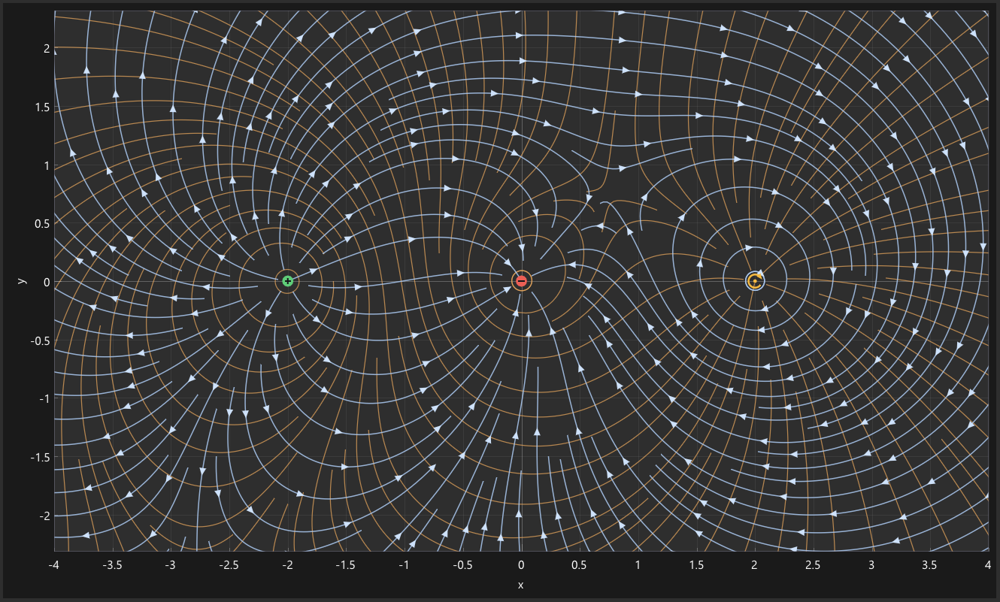
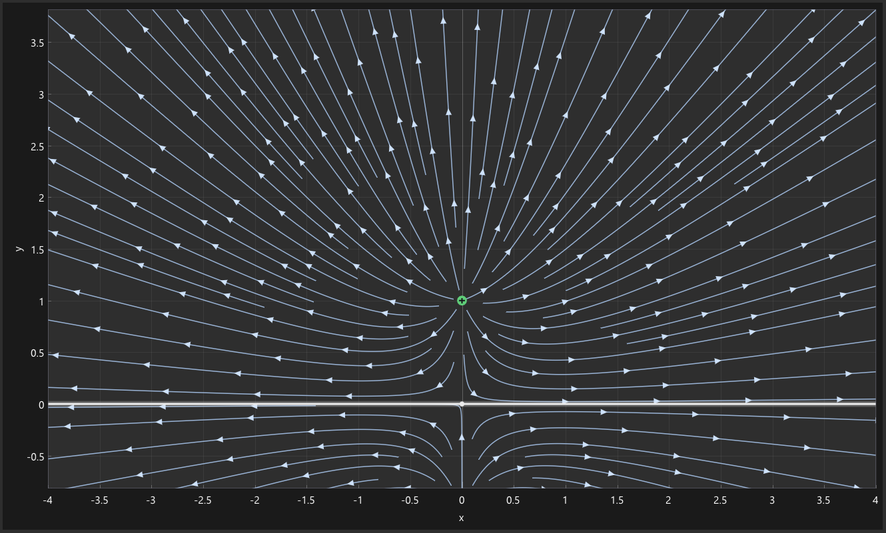
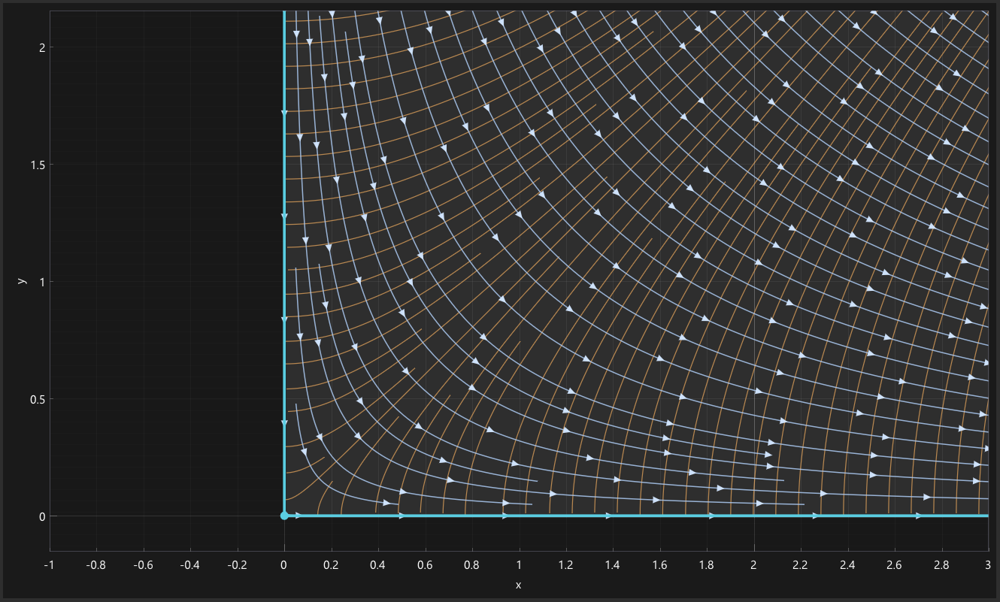
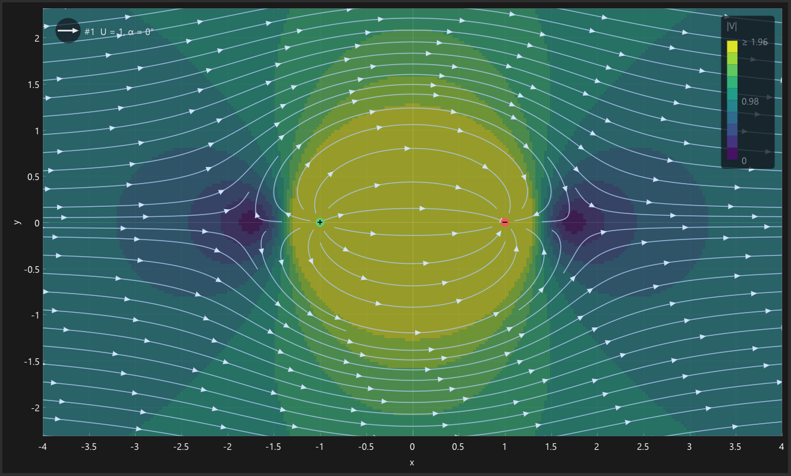
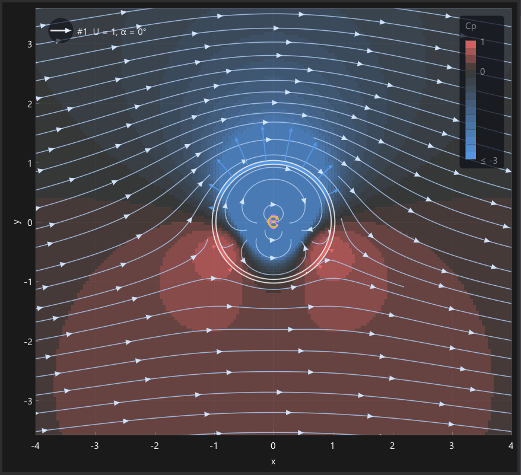

# Potential Flow Lab: An Interactive 2D Potential-Flow Simulator

**Semester Project 1, Mechanical Engineering, Fall 2026**
Deniz Işık

## 1. Objective and scope

The goal is a graphical program that builds two-dimensional, incompressible, irrotational flows by
superposing elementary solutions chosen by the user. Every time the configuration changes, the
program redraws the streamlines with arrows showing the flow direction. Potential Flow Lab provides
the six required building blocks: uniform flow, source/sink, point vortex, sector (wedge) flow,
doublet and straight symmetry wall. All of the specified interface is implemented: an icon toolbar
with parameter dialogs, a labelled (x, y) plot, an *Elements* menu for editing and deleting, and a
*File* menu with save, open, new and clear. The program also includes the optional extensions:
equipotential lines, velocity-magnitude contours, zoom and pan, selectable element markers, and
image and data export. It also plots the pressure coefficient where a free stream defines it: under
the mouse, as a colour map of the field, and along the surface of each body, together with the lift
and drag obtained by integrating it.

The program is written in C++20 (the brief allows Python, MATLAB, Julia or an equivalent language)
and uses Dear ImGui/ImPlot for the interface and OpenGL for the tracer particles. It ships as a
single self-contained Windows executable. The user guide (`docs/user_guide.md`) covers operation;
this report covers the mathematics, the architecture and the verification.

## 2. Theory

### 2.1 Complex potential and superposition

For a 2D incompressible, irrotational flow the velocity potential φ and the stream function ψ both
satisfy Laplace's equation. They combine into the complex potential F(z) = φ + iψ, an analytic
function of z = x + iy, whose derivative is the complex velocity

$$W(z) = \frac{dF}{dz} = u - i v .$$

Laplace's equation is linear, so the velocity of a combination of elementary flows is the sum of
their velocities. The program therefore evaluates

$$W(z) = \sum_k W_k(z), \qquad F(z) = \sum_k F_k(z)$$

at every point it needs. It never combines pictures of streamlines; the streamlines are always
traced through the summed velocity field (Section 4).

### 2.2 Elementary flows

With ζ = z − z₀ measured from the element's position, the elements are (sign conventions follow
Anderson, *Fundamentals of Aerodynamics*, ch. 3):

| Element | Parameters | F(z) | W(z) |
|---|---|---|---|
| Uniform flow | speed V∞ ≥ 0, direction α | V∞ e^(−iα) z | V∞ e^(−iα) |
| Source / sink | strength Λ (> 0 source, < 0 sink), z₀ | (Λ/2π) ln ζ | Λ / (2π ζ) |
| Point vortex | circulation Γ (> 0 clockwise), z₀ | (iΓ/2π) ln ζ | iΓ / (2π ζ) |
| Doublet | strength μ = κ/2π, z₀, axis angle β | μ e^(iβ) / ζ | −μ e^(iβ) / ζ² |
| Sector flow | V, vertex z₀, walls θ₁ < θ₂ | V (ζ e^(−iθ₁))ⁿ | V n e^(−iθ₁) (ζ e^(−iθ₁))ⁿ⁻¹ |

For the uniform flow, u = V∞ cos α and v = V∞ sin α. A source gives the radial velocity
V_r = Λ/(2πr), and a vortex the tangential velocity V_θ = −Γ/(2πr), so Γ > 0 turns clockwise.
A uniform flow at angle α plus a doublet with β = α is the flow past a circular cylinder of radius
a = √(μ/V∞). Section 6 checks this case in detail.

The sector flow uses the opening angle β_s = θ₂ − θ₁ (0 < β_s ≤ 2π) and the exponent n = π/β_s.
Its walls θ = θ₁ and θ = θ₂ are streamlines (ψ = 0). For n > 1 (β_s < π) the vertex is a stagnation
point (e.g. a 90° corner, n = 2). For n < 1 (β_s > π) the velocity is infinite at the vertex (e.g.
flow round the edge of a plate, β_s = 360°, n = ½). The fractional power ζⁿ is evaluated with the
local angle θ_ℓ = (arg ζ − θ₁) mod 2π, written as |ζ|ⁿ e^(inθ_ℓ). This places the branch cut of ζⁿ
along the first wall, outside the open wedge, so F is continuous everywhere inside it.

### 2.3 Pressure coefficient

When the scene contains a free stream of speed V∞ (the sum of its uniform flows), Bernoulli's
equation along the steady, irrotational flow gives

$$C_p = 1 - \frac{|V|^2}{V_\infty^2},$$

which the status bar shows under the mouse and the field export writes for every grid node. With
no uniform flow there is no physically meaningful reference speed, so Cp is left undefined.

**Surface pressure and forces.** Any streamline can be replaced by a solid wall. The bodies built
by superposition are bounded by the dividing streamlines through the stagnation points. Integrating
the surface pressure gives the force per unit span,

$$\frac{\mathbf F'}{q_\infty} = -\oint C_p\,\mathbf n\,ds, \qquad q_\infty = \tfrac12\rho V_\infty^2,$$

with n the outward normal (the constant p∞ integrates to zero around a closed surface). For an
isolated body in a uniform stream the exact results are zero drag (d'Alembert's paradox) and the
Kutta–Joukowski lift L′ = ρV∞Γ, i.e. L′/q∞ = 2Γ/V∞, with Γ the circulation enclosed. On a cylinder
of radius a, C_p = 1 − (2 sin(θ − α) + Γ/2πaV∞)², from the surface velocity V_θ = −2V∞ sin(θ − α) − Γ/2πa.

## 3. Boundary conditions, domains and singularities

### 3.1 Symmetry walls: method of images

A symmetry wall is an infinite straight line through a point w at angle φ. It must carry zero
normal velocity. Drawing a line is not enough; the program enforces the condition with the method
of images. Reflection across the wall is

$$\mathbf{p}' = \mathbf{w} + 2\left[(\mathbf{p}-\mathbf{w})\cdot\mathbf{t}\right]\mathbf{t} - (\mathbf{p}-\mathbf{w}),
\qquad \mathbf{t} = (\cos\varphi, \sin\varphi).$$

The image of an element has the complex potential F_img(z) = conj F(z′) (Schwarz reflection). On
the wall z′ = z, so F + F_img = 2 Re F is real there: ψ is constant along the wall, which is
therefore a streamline. For each element this gives:

- a source keeps its strength Λ at the mirrored position;
- a vortex changes sign (−Γ), because reflection reverses the sense of rotation;
- a doublet keeps μ and its axis becomes β′ = 2φ − β;
- a uniform flow is not imaged. Its image would cancel the normal component and double the
  tangential one. Instead the program keeps the free stream that an infinite wall admits: the
  component along the wall for a single wall or parallel walls, and none for walls that cross.

With several walls, every copy is reflected again across every wall until no new copy appears.
For one wall, or two walls meeting at π/k, this closes after a finite number of images and the
condition is exact. For other cases, such as two parallel walls (an infinite row of images), the
series is truncated at 32 images per element and the program warns that the wall condition is
approximate. The status bar always shows a live numerical check: the largest |v·n| sampled along
each wall in view, divided by the largest speed there.

### 3.2 Sector flow: admissible domain and interaction with other elements

The sector term is defined only inside its wedge 0 ≤ θ_ℓ ≤ θ₂ − θ₁. The program treats the
*admissible flow domain* as the intersection of the wedges of all sector flows in the scene. Outside
it the field is undefined. That region is darkened in the plot, no streamlines, equipotentials or
particles enter it, the probe reports "outside the flow domain", and the export writes NaN. The
interaction rules, stated explicitly as the brief requires, are:

1. Other elements are superposed without restriction inside the domain. They generally cross the
   sector's walls, so **the sector walls remain streamlines of the sector term only**. The program
   does not try to impose the wedge walls on other elements.
2. Symmetry walls do not mirror sector flows. A symmetry wall is a streamline of the sector term
   only if it runs along one of the sector's walls through its vertex; otherwise the program warns.
3. Several sector flows are allowed and restrict the domain to the intersection of their wedges
   (with a warning).

### 3.3 Singularities and invalid input

The source, vortex and doublet terms, and the sector term for n < 1, are infinite at their
centres. Each element's term is skipped within 10⁻⁹ of its singular point, so a sum evaluated
there stays finite. The streamline tracer stops 3 pixels from a singular point, and the speed map
puts singular cells in its top band. Coincident singularities are legal; a source and a vortex at
the same point form a spiral vortex. They are reported as a warning, as is an element lying on a
symmetry wall, where a vortex is cancelled by its own image. Invalid parameters are rejected in
the dialog before they can be applied, and the message names the problem. Examples are a negative
speed, non-finite numbers, and θ₂ − θ₁ outside (0°, 360°]. Scene files with invalid elements are
rejected on loading in the same way.

## 4. Numerical methods

**Streamlines.** Streamlines are integral curves of the unit direction field v/|v|, integrated
with classical fourth-order Runge–Kutta in steps of arc length. Using arc length gives slow and
fast regions the same resolution. The step is one sixth of the line separation, reduced to 15% of
the distance to the nearest singular point. Seeding follows Jobard and Lefer (1997). New seeds are
placed one separation beside existing lines, and a line stops when it comes within half a
separation of another, which gives evenly spaced lines whose density the user sets. A line also
stops at the domain boundary, near singular points, at stagnation points (speed below 10⁻⁶ of the
median speed, or the direction reversing within one step) and when it closes on itself. Arrows are
placed along each line at a fixed screen spacing, with a phase offset per line. All lines are
recomputed after every add, edit or delete, and whenever the view changes.

**Equipotential lines.** Equipotentials are traced by the same integrator applied to the rotated
field v⊥/|v| = (−v, u)/|v|. Because ∇φ = v is normal to these curves, φ is constant along each of
them, and they cross every streamline at right angles. Tracing was chosen over contouring φ on a
grid because φ is multivalued around a vortex. Its principal branch jumps by Γ across a cut, and
a contouring algorithm would draw spurious lines along that cut. The traced lines are unaffected
(Fig. 5). They use the same spacing as the streamlines, so where the speed is close to the typical
value the two families form an approximately square flow net.

**Velocity-magnitude contours.** |V| is sampled at the centres of 4-pixel cells over the view and
drawn in ten equal bands of the Viridis colour map, from 0 to twice the median speed in the view.
A colour scale is shown in the plot.

**Pressure coefficient.** The Cp background colours the same 4-pixel grid in bands of 0.25 on a
diverging scale: red above the free-stream pressure, blue below it, neutral grey at Cp = 0. The
scale runs from Cp = 1 (stagnation) down to the Cp of twice the median speed, which matches the |V|
scale.

**Body surfaces.** Stagnation points are found by Newton's method on the analytic W(z), started from
a 32 × 32 grid of seeds around the singular points. Around each one, v is sampled on a small circle.
Where it is radial, a dividing streamline leaves or arrives: four directions at a simple stagnation
point, six at a double one. These lines are traced with RK4 on v/|v|, with the step reduced near
stagnation points, where the direction turns quickly. Tracing stops at another stagnation point, at
a singularity or at the edge of the region. Two lines that leave one stagnation point and meet at
another form a closed body (cylinder, lifting cylinder, Rankine oval). Two that both leave the
region form a half-body. Cp is evaluated at every traced point (about 4000 per cylinder), and the
force integral uses the trapezoidal rule on the resulting polygon.

A closed streamline through two stagnation points requires ψ to be equal at both, which holds only
in a sufficiently symmetric flow. With other bodies nearby the two surfaces miss the rear
stagnation point slightly. Gaps up to 10 % of the stagnation-point spacing are closed with a short
segment and reported. A Rankine oval at incidence is not closed at all (ψ is odd about its centre,
so its stagnation points lie on ψ and −ψ), and the program reports that no body was found rather
than invent one.

**Tracer particles.** Optional animated particles use midpoint RK2. They are a visual aid only;
the streamlines are the result.

## 5. Software architecture

The code is split into libraries with one-way dependencies. The physics core has no graphics
dependency and is unit-tested on its own.

| Module | Contents | Depends on |
|---|---|---|
| `pfl_core` | elements, superposition, images, scene model, streamline/equipotential tracer, speed grid, body surfaces and forces, particles | C++ standard library only |
| `pfl_io` | JSON scene files (versioned, validated), CSV export | core, nlohmann/json |
| `pfl_render` | OpenGL particle layer | core, glad |
| `pfl_ui` | toolbar, menus, parameter dialog, plot view, surface-pressure panel, status bar | core, Dear ImGui, ImPlot |
| `PotentialFlowLab` | window, main loop, wiring, file dialogs, PNG writer, command line | all of the above, GLFW |

**Data flow.** The interface edits a `Scene` (the element list plus the plot settings).
`buildFlowModel` turns it into the field that is actually evaluated: the original elements, their
wall images and the wall-constrained uniform flows. The streamline tracer, equipotential tracer,
speed and Cp maps, body surfaces, particles, probe and exports all read this one `FlowField`, so
whatever is drawn or exported comes from a single source of truth.

**Interface.** The toolbar has one icon per element type, with the name on hover. A click opens a
modal dialog with Apply and Cancel, and Apply stays disabled until the input is valid. The plot
has labelled axes with equal scales, scroll-to-zoom and drag-to-pan. Hovering an element marker
names it, and double-clicking opens it for editing. The *Elements* menu lists every element with
its parameters, each with Edit and Delete. The *View* menu holds streamline density, arrows, wall
images, equipotentials, the |V| or Cp background, surface pressure and particles. *Surface
pressure* colours each body surface by Cp, draws pressure arrows normal to it (inwards where
Cp > 0, outwards where Cp < 0), and opens a side panel. The panel plots Cp against the angle around
the body, x/c or arc length (Cp axis inverted, exact curve underneath for a cylinder) and lists the
integrated drag and lift next to their exact values. Hovering the plot marks the matching point on
the body. The *File* menu provides New, Open, Save, Save As, Clear All and the four exports.

**Files and exports.** A scene is saved as a versioned JSON file containing every element with its
parameters, the walls, the view limits and all View-menu settings. Opening it restores all of
these. Exports are a PNG of the plot with axes, a CSV of x, y, u, v, |V|, φ, ψ and Cp on a
201-column grid, a CSV of every streamline and equipotential polyline, and a CSV of the body
surfaces (x, y, arc length, x/c, angle, Cp and the exact cylinder Cp). Numbers are written in the
shortest form that reads back as the identical double. The same exports are available from the
command line (`PotentialFlowLab.exe scene.json --export-image out.png --export-surface out.csv`),
which `tools/report_figures.py` uses to produce every figure and number in Section 6.

## 6. Verification

The unit-test suite (doctest, 35 test cases, 8721 assertions, all passing) covers each minimum
verification case of the brief. The script `tools/report_figures.py` adds an independent check. It
exports the program's field on a 201 × 117 grid and compares it with the classical closed-form
solutions, written in polar form in Python without reference to the program's complex-potential
code.

| Brief's verification case | Check | Result |
|---|---|---|
| Uniform flow, α = 0° and 45° | velocity at (3, −2); every streamline straight and parallel to (1, 1); every arrow along (√½, √½) | (0.707107, 0.707107); all lines and arrows pass |
| Source, sink, vortex signs | Λ = 2π at (1, 0); Γ = 2π at (1, 0) and (0, 1); vortex streamlines | (1, 0); (0, −1) and (1, 0), i.e. clockwise; closed circles, radius drift < 10⁻⁵ |
| Uniform flow + doublet (cylinder) | V∞ = 1, μ = 1: velocity at (0, a); V_r on r = a for α = 30°; Cp along x = 0 | (2, 0); V_r = 0 and V_θ = −2V∞ sin(θ − α); Fig. 1 |
| Cylinder with circulation | Γ = 2π: velocity at (0, a); stagnation points | (3, 0); stagnation at 210° and 330° (sin θ = −Γ/4πV∞a) |
| Symmetry wall | max \|v·n\| / \|V\| along the wall, 200 samples | 1.9 × 10⁻¹⁶ (inclined wall with every element type); 2.1 × 10⁻¹⁶ and 1.2 × 10⁻¹⁶ (two perpendicular walls) |
| Save, reopen | all six element types plus plot settings, saved and reloaded | identical element list and settings, identical velocities; all 9 example scenes load |

Further tests check that W = dF/dz numerically for every element type, and that the sector walls
carry zero normal velocity. For the equipotentials, φ varies by less than 10⁻⁴ of the line spacing
Δφ along each traced line, each step crosses the local velocity within 0.06° of a right angle,
and the lines around a vortex are exactly radial even though φ jumps by Γ across its branch cut.

Comparison of the exported field with the closed-form solutions (maximum of |V_program − V_exact|
relative to max(|V_exact|, median speed) over all defined grid nodes):

| Case | Defined nodes | Masked / singular nodes | Max. relative velocity error |
|---|---:|---:|---:|
| Uniform flow, U = 1, α = 45° | 23517 | 0 | 0 |
| Source Λ = 2π, sink Λ = −2π, vortex Γ = 2π | 23514 | 3 | 1.0 × 10⁻¹⁵ |
| Cylinder: uniform + doublet μ = 1 (a = 1) | 23516 | 1 | 1.0 × 10⁻¹⁵ |
| Lifting cylinder, Γ = 2π | 23516 | 1 | 1.2 × 10⁻¹⁵ |
| Rankine half-body | 23516 | 1 | 6.5 × 10⁻¹⁶ |
| Rankine oval | 23515 | 2 | 8.3 × 10⁻¹⁶ |
| Source above the wall y = 0 (exact: image source) | 23517 | 0 | 8.2 × 10⁻¹⁶ |
| Sector flow, 90° corner (n = 2) | 16308 | 7008 | 3.9 × 10⁻¹⁶ |
| Sector flow, 360° plate edge (n = ½) | 23516 | 1 | 4.2 × 10⁻¹⁶ |

The program reproduces every closed-form solution to machine precision. The masked nodes are the
grid nodes that fall on a singular point, plus, for the 90° corner, every node outside the wedge
x ≥ 0, y ≥ 0.

*Figure 1. Pressure coefficient along x = 0 above the cylinder (a = 1, V∞ = 1). Markers: program
export. Lines: Cp = 1 − (1 + a²/y² + Γ/2πV∞y)². At the surface Cp = −3 without circulation and
−8 with Γ = 2π.*

The surface export of the closed bodies is checked the same way. Its Cp is compared with the exact
cylinder distribution, and the script integrates it around each body for drag and lift
(`docs/figures/validation.md`):

| Body | Surface points | Max. Cp error (exact cylinder) | D′/q∞ | L′/q∞ | Exact L′/q∞ = 2Γ/V∞ |
|---|---:|---:|---:|---:|---:|
| Cylinder, a = 1 | 4019 | 1.3 × 10⁻¹⁰ | 5.7 × 10⁻⁹ | 0.00000 | 0 |
| Lifting cylinder, Γ = 2π | 4020 | 1.7 × 10⁻¹⁰ | 3.5 × 10⁻⁹ | 12.56637 | 12.56637 |
| Rankine oval | 967 | – | 1.3 × 10⁻⁶ | 0.00000 | 0 |

D'Alembert's paradox and the Kutta–Joukowski theorem are reproduced to the accuracy of the
trapezoidal rule. The unit tests check the same for a lifting cylinder at α = 20° and for the
dividing-streamline loop of a cylinder with Γ > 4πaV∞. They also check that half-bodies come out
open, and that a Rankine oval at incidence is reported as not closed.

*Figure 2. Surface Cp of the cylinder (a = 1, V∞ = 1) against the angle from the free-stream
direction, Cp axis inverted. Markers: surface export (every 36th point). Lines: C_p = 1 − (2 sin θ +
Γ/2πaV∞)².*

## 7. Examples

*Figure 3 (left). Non-lifting cylinder with |V| contours: stagnation (dark) at θ = 0° and 180°,
|V| = 2V∞ at the top and bottom. Figure 4 (right). Lifting cylinder, Γ = 2π, with equipotential
lines (orange): the stagnation points move down to 210° and 330°.*

*Figure 5 (left). Source (green), sink (red) and clockwise vortex (orange) with equipotentials. The
equipotentials are radial around the vortex and continuous across its branch cut. Figure 6
(right). Source above the symmetry wall y = 0: no streamline crosses the wall. The image source
below the wall is outside the view.*

*Figure 7 (left). Sector flow in a 90° corner (n = 2) with equipotentials. The region outside the
wedge is masked. Figure 8 (right). Rankine oval (uniform flow, source and sink) with |V|
contours.*

*Figure 9. Lifting cylinder, Γ = 2π, with the Cp background and surface pressure. Red is above
and blue below the free-stream pressure. The arrows show suction over the top and pressure near the
two stagnation points, whose net effect is the lift L′/q∞ = 4π.*

## 8. Limitations and conclusions

- RK4 with a fixed arc-length step is least accurate where the direction field turns quickly,
  near stagnation points and inside the doublet. Lines there may stop short or kink slightly (for
  example the dividing streamline on the cylinder surface is not drawn through the stagnation
  points; the surface-pressure tracer, which refines its step there, does reach them). This
  affects the picture only; the field values are exact.
- Body surfaces are found through their stagnation points. A cylinder with Γ > 4πaV∞ has its only
  stagnation point off the surface, so the body found is the dividing-streamline loop around it
  (same forces). Bodies with more than two stagnation points on the surface are not assembled.
- Walls that do not close the image system (parallel walls, or angles other than π/k) are
  approximated with 32 images per element, and the program warns when this happens.
- The sector walls are streamlines of the sector term only, not of the superposed flow
  (Section 3.2). This is the defined behaviour, not a numerical error.
- The exported φ (with vortices) and ψ (with sources) use the principal branch of log and jump
  across a cut running in −x from each such element.

Potential Flow Lab meets the functional and physical requirements of the brief. The required
elements are superposed at the velocity level, symmetry walls are enforced with exact image systems
and verified to |v·n|/|V| ≈ 10⁻¹⁶, the sector flow's domain and interactions are defined and
enforced, and the interface provides the required toolbar, dialogs, Elements and File menus, and
saved configurations. Every elementary and combined flow tested matches its closed-form solution to
machine precision.

## References

1. J. D. Anderson, *Fundamentals of Aerodynamics*, 6th ed., McGraw-Hill, 2017, ch. 3.
2. B. Jobard and W. Lefer, "Creating evenly-spaced streamlines of arbitrary density," in
   *Visualization in Scientific Computing '97*, Springer, 1997, pp. 43–55.
